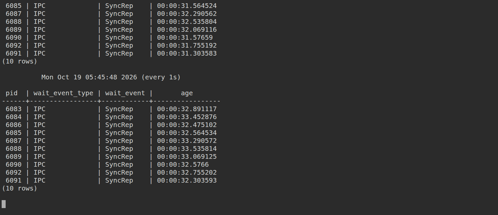
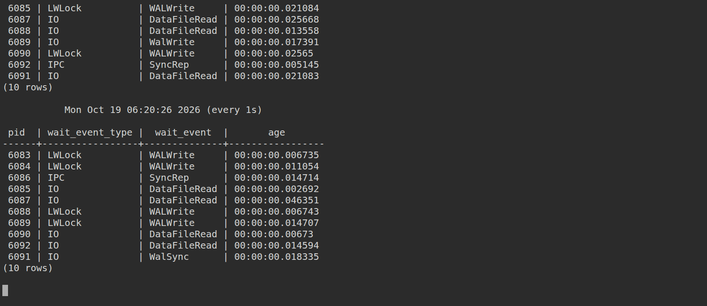
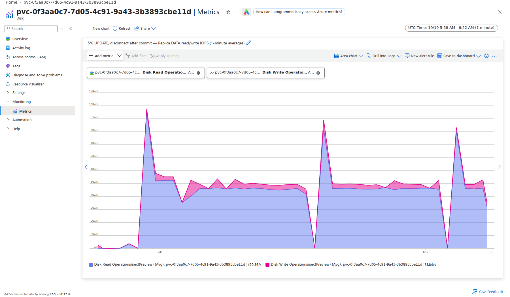
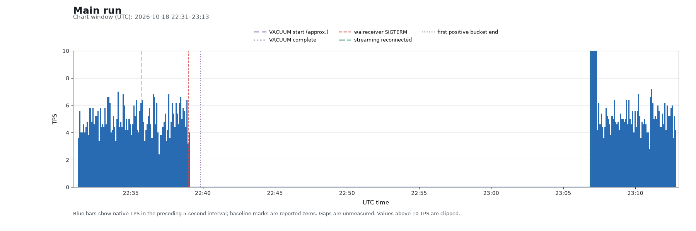

# walreceiver disconnect after a 5% UPDATE

With **synchronous replication** enabled, an **8 GiB** pgbench table, a checkpoint
followed by a **5% UPDATE**, and one SIGTERM to the replica's walreceiver after
UPDATE commits reproduce a write outage. Standard pgbench
prints `--progress=5` so a write outage is visible as repeated `0.0 tps` lines.

CloudNativePG runs PostgreSQL **18** on two separate AKS nodes (`Standard_D2s_v6`,
2 CPUs / 8 GiB each). Each instance has separate 64 GiB **Standard HDD** DATA and
WAL disks, host caching disabled, rated up to **500 IOPS**. WAL archives go to
**Azure Blob Storage**. No metrics stack.

For an UPDATE-only experiment without a disconnect or background workload, see
the [local cgroup prefetch reproduction](local/prefetch/README.md). It measures
primary and replica read operations and MB on the same local disk.

## Setup

Requires Bash, Azure CLI logged in to your subscription, and kubectl:

Before provisioning, check for other running experiments and confirm regional
VM availability and quota for two `Standard_D2s_v6` nodes (four vCPUs). Choose
`LOCATION` accordingly; preserve resources belonging to other tests.

```bash
./provision.sh                 # LOCATION=eastus by default
source .repro.env
kubectl exec postgres-1 -c postgres -- pgbench --username=postgres \
  --initialize --scale=640 postgres

kubectl exec postgres-1 -c postgres -- psql -X -U postgres -v ON_ERROR_STOP=1 \
  -c 'ALTER TABLE pgbench_accounts SET (autovacuum_enabled = false)'
```

This uses CNPG 1.30.1's [built-in Barman integration](https://cloudnative-pg.io/docs/1.30/appendixes/backup_barmanobjectstore/)
to keep the reproduction small. That integration is deprecated upstream but
remains functional in this release. The PostgreSQL image floats at
`ghcr.io/cloudnative-pg/postgresql:18`.

Disabling accounts-table autovacuum prevents routine background vacuum during
the measurement.

Check replay lag before starting pgbench:

```bash
kubectl exec postgres-1 -c postgres -- psql -X -U postgres \
  -c 'SELECT pg_size_pretty(pg_current_wal_lsn() - replay_lsn) AS replay_lag FROM pg_stat_replication'
```

Proceed when replay lag is `0 bytes`; allow setup archiving and I/O to
settle before collecting the baseline. Replay catch-up alone does not establish
that Blob archiving has caught up. The Cluster YAML configures synchronous
replication and the Blob backup destination.

On this fresh cluster, `postgres-1` is the primary and `postgres-2` the replica.
Check their roles and separate nodes:

```bash
kubectl get pods -l cnpg.io/cluster=postgres -o wide --show-labels
```

## Terminal 1: run pgbench

```bash
source .repro.env
kubectl exec postgres-1 -c postgres -- pgbench --username=postgres \
  --builtin=tpcb-like --no-vacuum --client=10 --rate=5 --time=14400 \
  --progress=5 --progress-timestamp postgres
```

Wait for several healthy progress lines at approximately 5 TPS.

## Terminal 2: observe waits

```bash
source .repro.env
echo "SELECT pid, wait_event_type, wait_event, clock_timestamp()-xact_start AS age FROM pg_stat_activity WHERE application_name='pgbench'; \watch 1" | kubectl exec -i postgres-1 -c postgres -- psql -X -U postgres
```

## Terminal 3: observe lag

```bash
source .repro.env
echo 'SELECT pg_size_pretty(flush_lsn - replay_lsn) AS replay_lag FROM pg_stat_replication; \watch 1' | kubectl exec -i postgres-1 -c postgres -- psql -X -U postgres
```

The row disappears while the replica is disconnected from streaming.

## Terminal 4: write burst, then disconnect

```bash
source .repro.env
kubectl exec postgres-1 -c postgres -- psql -X -U postgres -v ON_ERROR_STOP=1 \
  -c CHECKPOINT \
  -c 'UPDATE pgbench_accounts SET abalance = abalance + 1 WHERE aid % 20 = 0'
```

This updates **3,200,000 of 64,000,000 accounts**, spread across the table.
Keep the default synchronous commit settings. Wait for successful completion
with `UPDATE 3200000`, then for pgbench to complete writes again. Only then send
**one** SIGTERM to the streaming walreceiver; do not disconnect during UPDATE:

```bash
pid=$(kubectl exec postgres-2 -c postgres -- psql -X -U postgres -Atc \
  "SELECT pid FROM pg_stat_wal_receiver WHERE status='streaming'")
test -n "$pid" && kubectl exec postgres-2 -c postgres -- sh -c 'kill -TERM "$1"' sh "$pid"
```

Watch for `0.0 tps`, `IPC / SyncRep` waits, and archive recovery in the replica log:

```bash
kubectl logs postgres-2 -c postgres --since=2m | tail -20
```

Keep pgbench running until streaming and TPS resume. Duration depends on archive
backlog and disk behavior. During UPDATE, pgbench can stall on row locks held
by the bulk transaction; distinguish those waits from post-disconnect `SyncRep`
waits. Keep the offered load running throughout UPDATE and recovery, until
streaming has actually reconnected, TPS is healthy, and replay has caught up.
For a control, repeat on a fresh cluster without SIGTERM.

## Cleanup

**Delete the cluster when finished.** Stopping pgbench does not stop billing:

```bash
./cleanup.sh
```

This deletes the unique resource group, AKS nodes, all four PostgreSQL disks,
and the Blob account including backups. To find those disks in Azure Portal:

```bash
kubectl get pv -o custom-columns=CLAIM:.spec.claimRef.name,DISK:.spec.csi.volumeHandle
```

## Test variations

| Run | Description |
| --- | --- |
| Main reproduction | 5% UPDATE, then walreceiver SIGTERM after commit and resumed writes; required synchronous replication. |
| No disconnect (control) | The same workload without terminating the walreceiver. |
| `recovery_prefetch=off` | Disable recovery prefetch; use the same 5% UPDATE and disconnect after commit and resumed writes. |
| Preferred durability | Use `dataDurability: preferred` with default readiness. |
| Preferred durability with streaming readiness | Use preferred durability and streaming readiness with defaults. |
| VACUUM variation | VACUUM (FREEZE) instead of 5% UPDATE, with unfrozen initialization and disconnect during VACUUM. |

See the [test variations and screenshots](variations/README.md).

## Results

The main run completed on 2026-10-19 in East US on two `Standard_D2s_v6`
nodes, with PostgreSQL 18.6 and CNPG 1.30.1. All four [UPDATE variations](variations/README.md) are also complete.
The [VACUUM variation](variations/README.md#vacuum-instead-of-5-update) retains
its existing results and was not rerun.

After CHECKPOINT, UPDATE ran from approximately 05:40:04 to 05:45:03 UTC and
successfully changed **3,200,000 rows**. pgbench resumed writes before the
single walreceiver SIGTERM at approximately 05:45:15 UTC. Replay lag just
before disconnect was about 9.3 GB. Row-lock stalls during UPDATE were distinct
from the subsequent replication waits.

About 34 seconds after disconnect, all ten clients waited on `IPC/SyncRep`.
There were **420 consecutive zero-TPS reporting intervals**, about 35 minutes.
Streaming reconnected at approximately **06:20:21.8 UTC**. The first positive
five-second bucket ended at 06:20:22.422 UTC (33.6 TPS); that bucket end does
not establish the exact first completed transaction time. TPS returned to
approximately 5, and replay lag was zero by 06:21:08 UTC. Required synchronous
replication remained enabled throughout.

The experiment and managed node resource groups were verified absent after
cleanup. Native progress logs were saved before deletion; pgbench was stopped
after recovery and its logs contain no final summary block.

### Waits before disconnect

Captured at approximately 05:45:13 UTC, after UPDATE committed and writes resumed.


### Waits after disconnect

Captured at approximately 05:45:49 UTC, about 34 seconds after SIGTERM.



### Waits after reconnect

Streaming reconnected at approximately **06:20:21.8 UTC**; captured at
approximately 06:20:27 UTC while pgbench was running.



### Azure disk IOPS and TPS

Common chart window: **05:38–06:22 UTC on 2026-10-19** (East US,
`Standard_D2s_v6`). Azure DATA disk read/write IOPS use stacked areas with
one-minute averages. TPS retains native five-second intervals on a fixed
0–10 axis; values above 10 TPS are clipped.





