# Test variations

- [No disconnect (control)](#no-disconnect-control)
- [recovery_prefetch=off](#recovery_prefetchoff)
- [Preferred durability](#preferred-durability)
- [Preferred durability with streaming readiness](#preferred-durability-with-streaming-readiness)
- [VACUUM instead of 5% UPDATE](#vacuum-instead-of-5-update)

Use a fresh cluster for each variation. Follow the [main README](../README.md)
for default pgbench initialization, accounts-table autovacuum disablement, replay
catch-up, the same ten-client 5 TPS workload, checkpoint, and **5% UPDATE**.
For every UPDATE variation with a disconnect, wait for `UPDATE 3200000` and
resumed pgbench writes before sending one walreceiver SIGTERM. The old 512 MiB
and five-minute triggers do not apply to these UPDATE variations.

All four UPDATE variations below are complete. The VACUUM variation retains
its existing results and was not rerun. All UPDATE runs used two `Standard_D2s_v6`
nodes and committed 3,200,000 rows. Native logs were retained; pgbench was stopped
after recovery without final statistics blocks. All test resource groups were
verified absent after cleanup.

Azure DATA IOPS charts show stacked read/write areas with one-minute averages.
TPS plots use five-second intervals and a fixed 0–10 axis; higher values are
clipped. TPS bucket ends and observed state changes give approximate recovery
times.

## No disconnect (control)

Follow the main UPDATE reproduction without terminating the walreceiver.
Keep pgbench running through UPDATE completion, replay catch-up, and healthy
subsequent progress.

### Results

UPDATE caused 125 seconds of zero TPS with row-lock waits. After it committed,
**writes continued throughout replica catch-up**, with no zero-TPS buckets.
Replay lag reached zero around **08:15:10 UTC**, about 31 minutes after commit.
Streaming stayed connected throughout.

Initial waits, watch timestamp approximately 07:38:57 UTC:

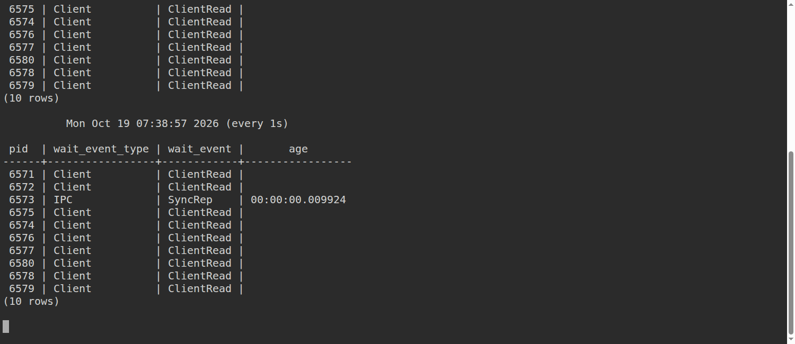

Waits after UPDATE and replay catch-up, approximately 08:15:12 UTC:

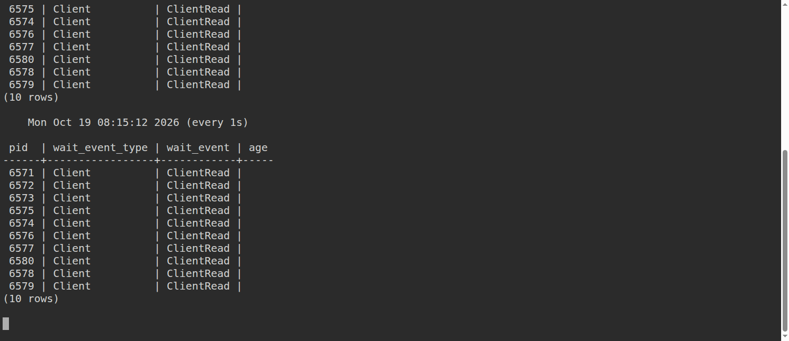

Final waits at approximately 08:17:07 UTC; no disconnect occurred:


Chart window: **07:37–08:17 UTC on 2026-10-19** (East US).

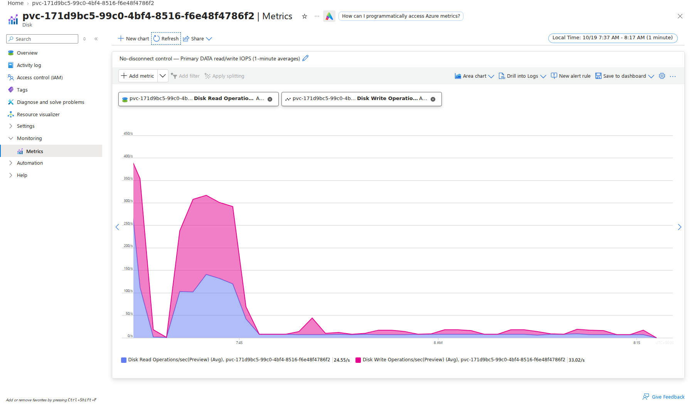

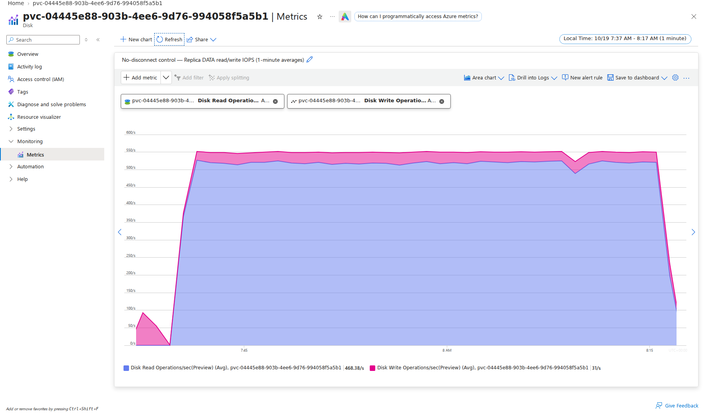

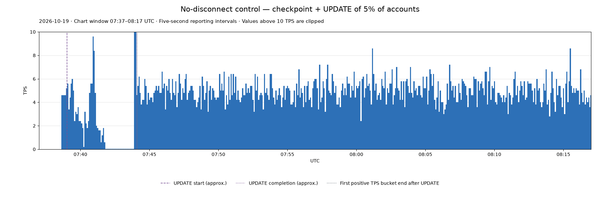

## recovery_prefetch=off

Before initialization, set recovery prefetch off on this variation's fresh cluster:

```bash
kubectl patch cluster postgres --type merge --patch \
  '{"spec":{"postgresql":{"parameters":{"recovery_prefetch":"off"}}}}'
```

Verify the setting on the replica before starting the workload:

```bash
kubectl exec postgres-2 -c postgres -- psql -X -U postgres -c 'SHOW recovery_prefetch'
```

It must return `off`. Follow the main UPDATE reproduction, disconnecting only
after commit and resumed pgbench writes.

### Results

UPDATE caused 95 seconds of zero TPS with row-lock waits. After disconnect at
07:34:39.5 UTC, **streaming reconnected about 0.6 seconds later**, with no
zero-TPS buckets after disconnect. Synchronous replication stayed enabled.
At the one-minute capture, replay lag was zero and all ten sessions showed
`ClientRead`.

Before disconnect, after UPDATE committed and writes resumed; watch timestamp
approximately 07:34:36 UTC:

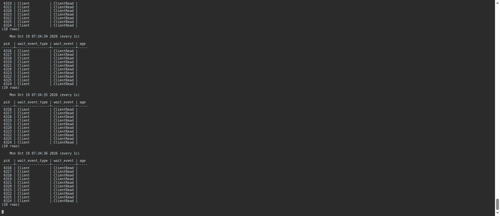

About 64 seconds after disconnect, captured at approximately 07:35:43 UTC:


Streaming reconnected at approximately **07:34:40.1 UTC**; captured at
approximately 07:35:48 UTC while pgbench was running:

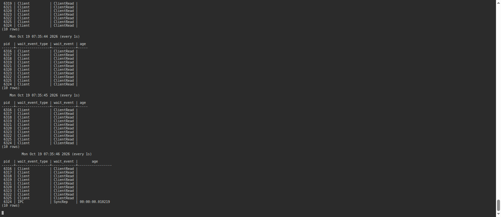

Chart window: **07:23–07:43 UTC on 2026-10-19** (West US 2).

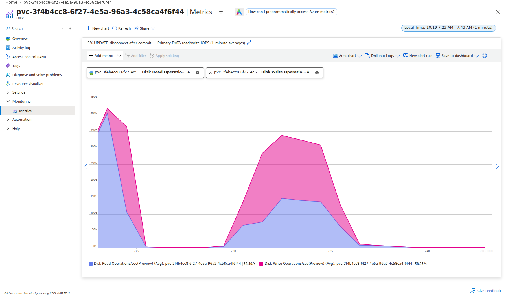

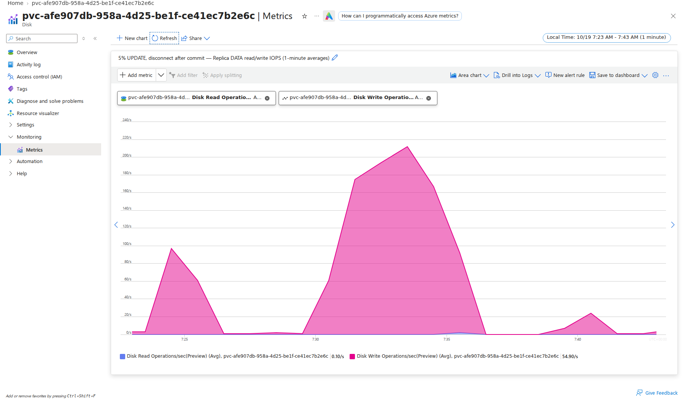

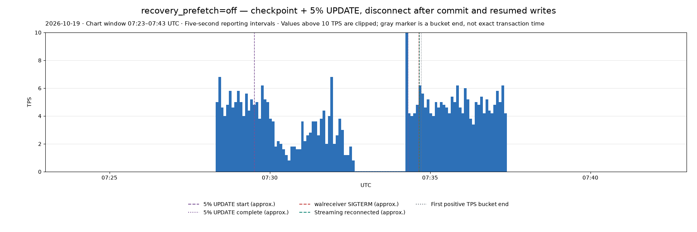

## Preferred durability

Follow the main UPDATE reproduction with `dataDurability: preferred` and the
default `wal_sender_timeout`. Apply this Cluster patch after provisioning and
before initialization (commands run from the repository root):

```bash
kubectl patch cluster postgres --type merge --patch-file variations/preferred.yaml
```

Use default recovery prefetch on this fresh run; do not carry over the
prefetch-off setting. Disconnect only after UPDATE commits and pgbench resumes.

### Results

Disconnect at approximately 06:40:22 UTC left about 8.3 GiB of replay lag.
All ten sessions showed `SyncRep` in both post-disconnect captures, and
**445 consecutive zero-TPS buckets covered 37 minutes 5 seconds**.
Synchronous replication stayed enabled. Writes resumed in the bucket ending
07:17:33 UTC; streaming was confirmed reconnected around **07:17:37 UTC**,
with zero replay lag.

Before disconnect, after UPDATE committed and writes resumed; watch timestamp
06:40:20 UTC:

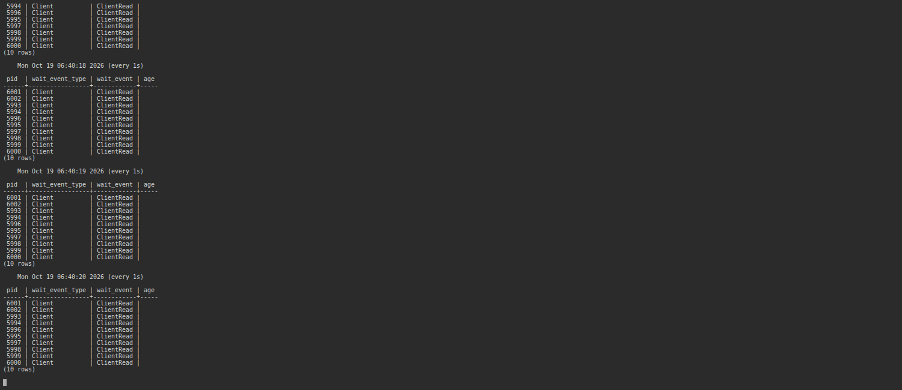

Watch timestamp 06:40:37 UTC, about 15 seconds after disconnect:

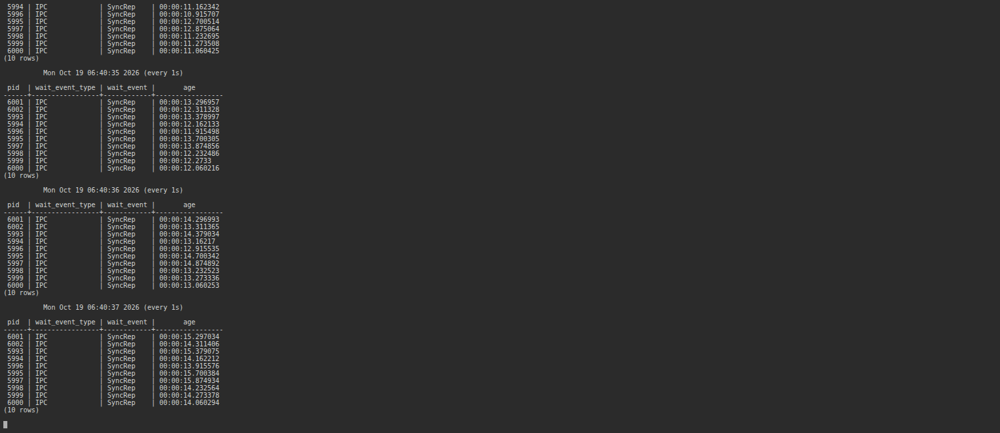

Watch timestamp 06:41:39 UTC, about one minute after the previous capture:

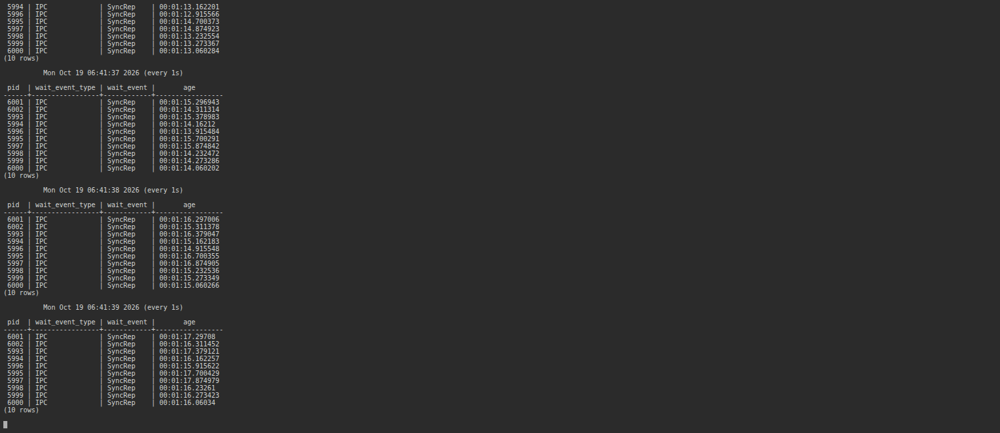

Streaming was confirmed reconnected at approximately **07:17:37 UTC**.
Captured immediately afterward; the latest watch refresh is 07:17:36 UTC:

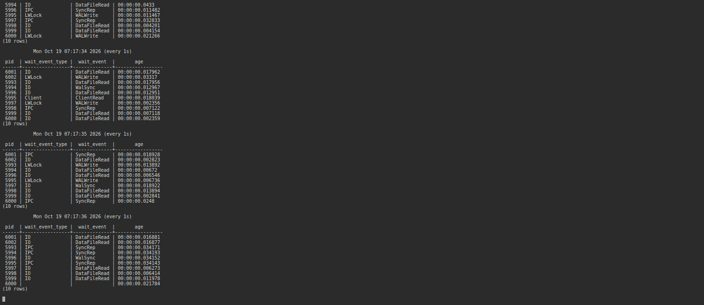

Chart window: **06:32–07:24 UTC on 2026-10-19** (West US 2).

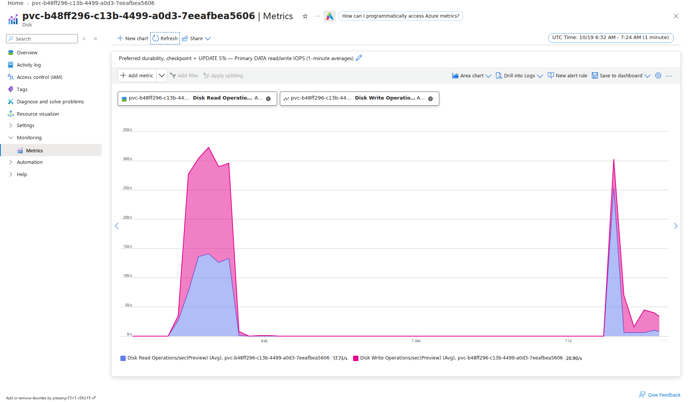

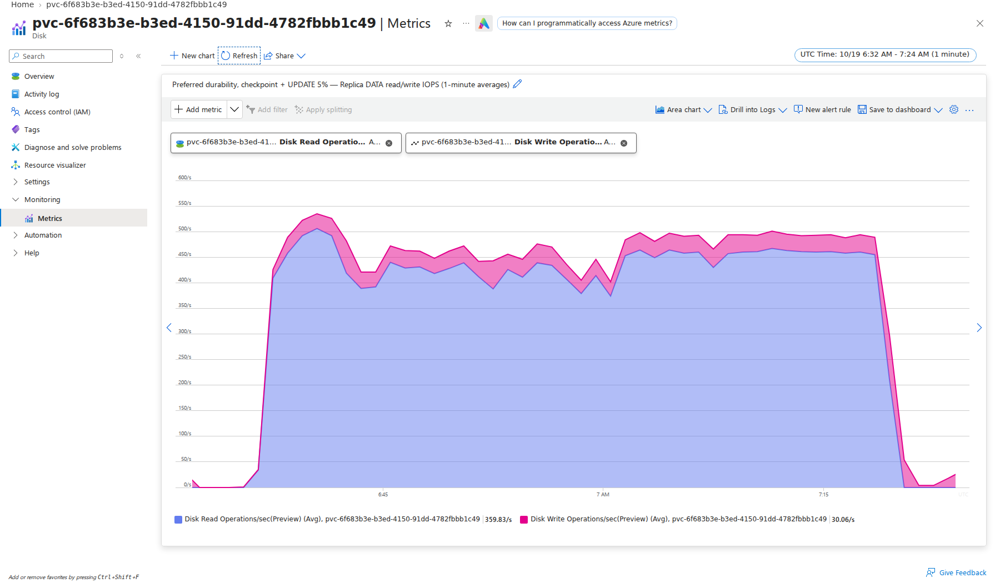

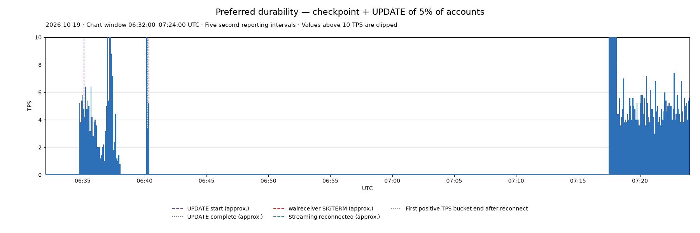

## Preferred durability with streaming readiness

Follow the main UPDATE reproduction with `dataDurability: preferred` and default
streaming readiness (no lag limit). Apply this Cluster patch after provisioning
and before initialization; leave `maximumLag` and probe timing fields unset:

```bash
kubectl patch cluster postgres --type merge --patch-file variations/preferred-streaming.yaml
```

Use default recovery prefetch on this fresh run; do not carry over the
prefetch-off setting. Disconnect only after UPDATE commits and pgbench resumes.

### Results

After disconnect around 09:00:05 UTC, all ten sessions initially showed
`SyncRep`. **Three zero-TPS buckets covered 15 seconds**; writes resumed in
the bucket ending 09:00:30 UTC. Synchronous replication was first observed
relaxed around that time, about 26 seconds after disconnect.

Streaming reconnected around **09:34:36 UTC**, about 34½ minutes later.
The replica DATA disk stayed near 500 IOPS through most of catch-up while
writes continued. Replay lag was confirmed zero at 09:34:58 UTC.

Before disconnect, after UPDATE committed and writes resumed; watch timestamp
09:00:03 UTC:

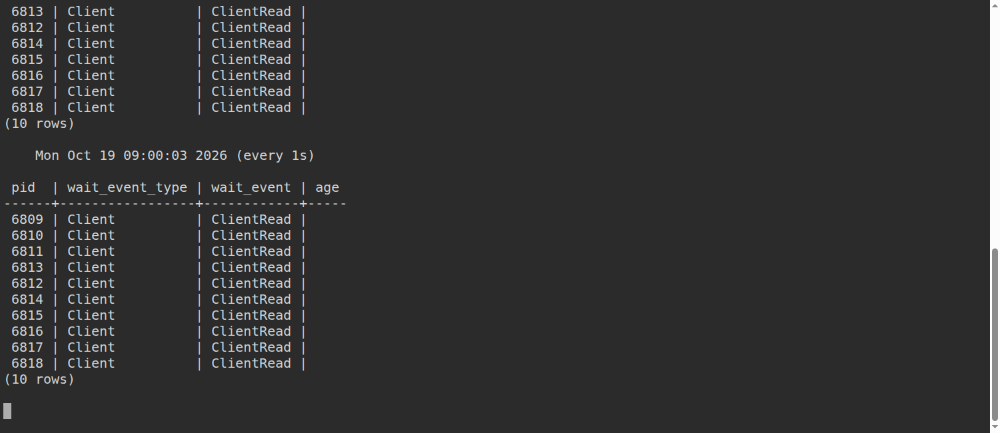

Watch timestamp 09:00:25 UTC, about 20 seconds after disconnect:

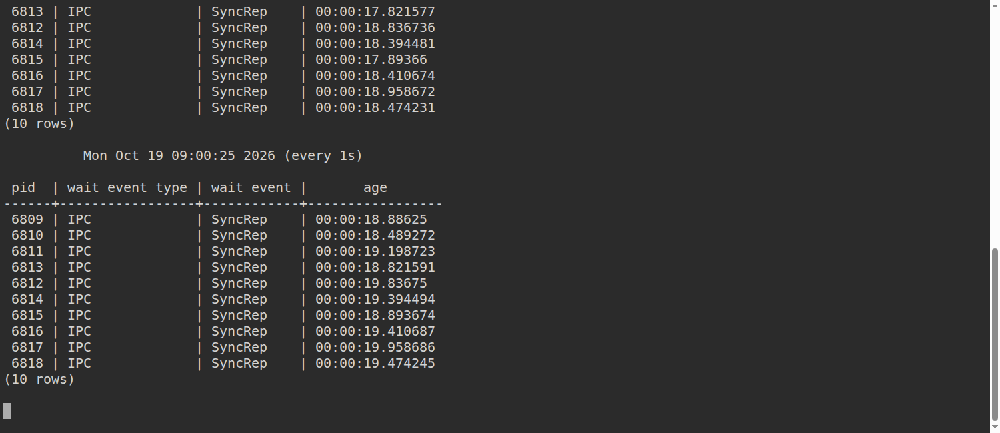

Watch timestamp 09:01:24 UTC, about one minute after the previous capture:

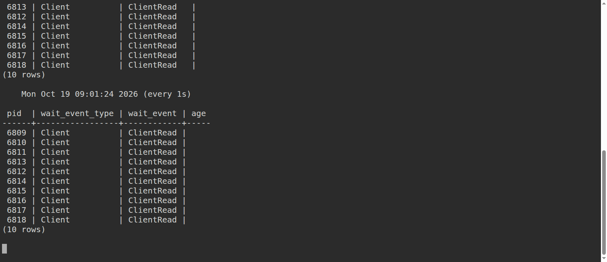

Streaming reconnected at approximately **09:34:36 UTC**; watch timestamp
09:34:43 UTC while pgbench was running:

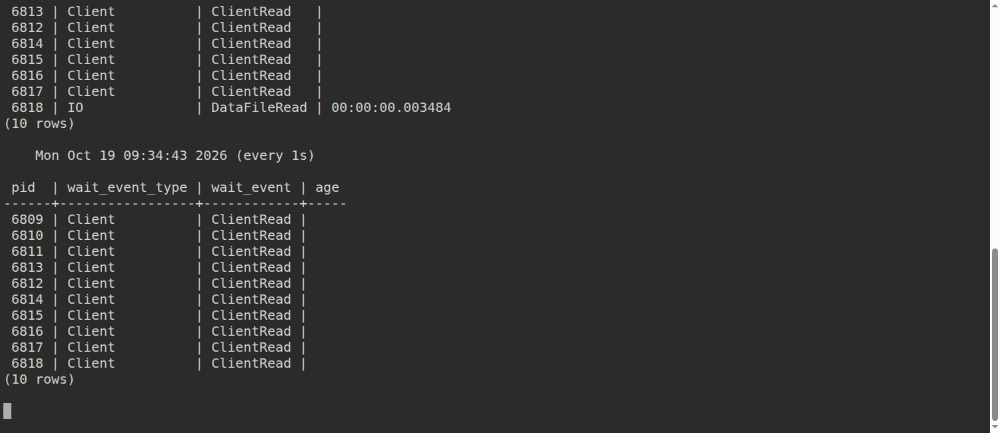

Chart window: **08:53–09:36 UTC on 2026-10-19** (West US 3).

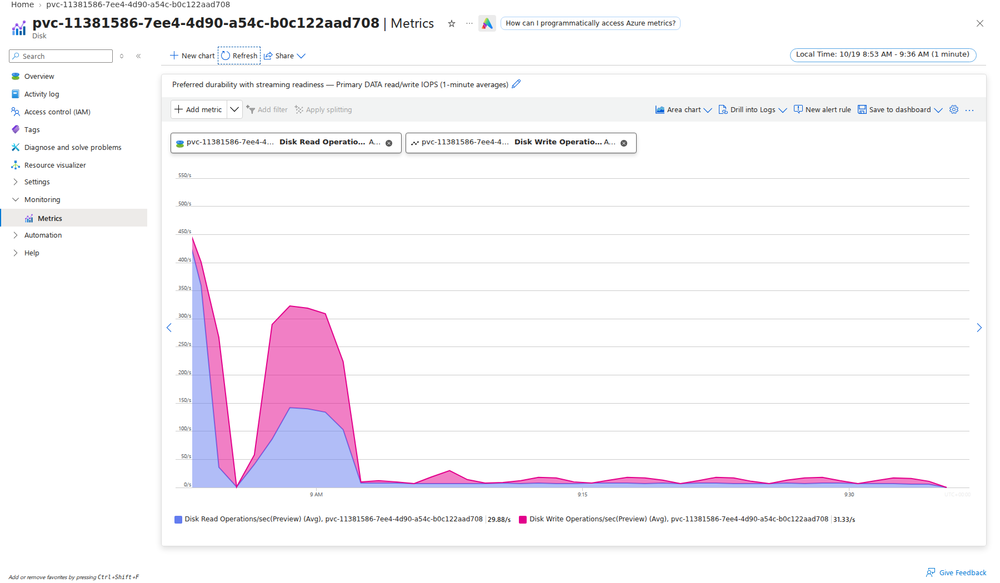

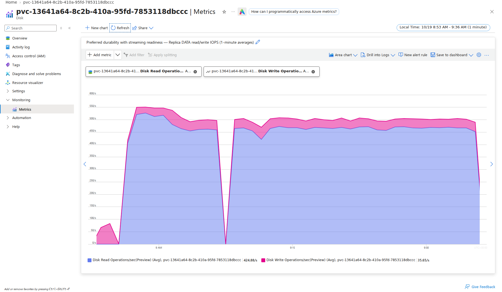

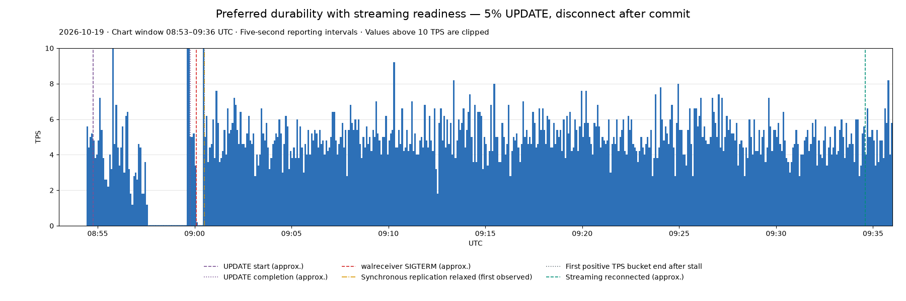

## VACUUM instead of 5% UPDATE

Use `VACUUM (FREEZE) pgbench_accounts` after the checkpoint instead of 5% UPDATE.
Load unfrozen rows with `--init-steps=dtGp` and disconnect at 512 MiB of replay
lag while VACUUM is running and pgbench is still completing writes, rather than
after UPDATE commits and writes resume.

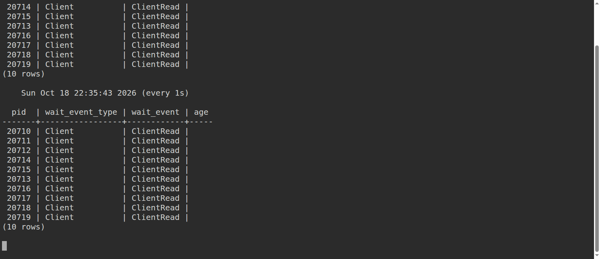

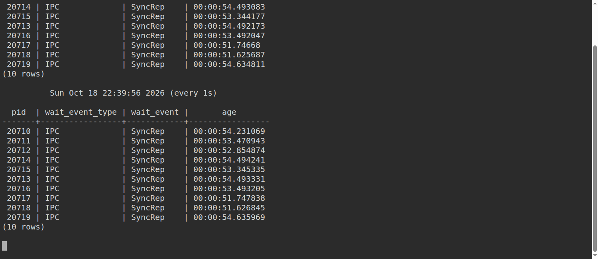

Streaming reconnected at approximately 23:06:51 UTC.


Azure read/write IOPS (one-minute granularity selected), 22:31–23:13 UTC on 2026-10-18 (East US, Standard_D2s_v4).
VACUUM was active by 22:35:54; the disconnect was around 22:39:02; VACUUM
completed at 22:39:50. Streaming reconnected around 23:06:51; the first positive
TPS bucket ended at 23:06:56, after 333 zero-TPS intervals (about 28 minutes).

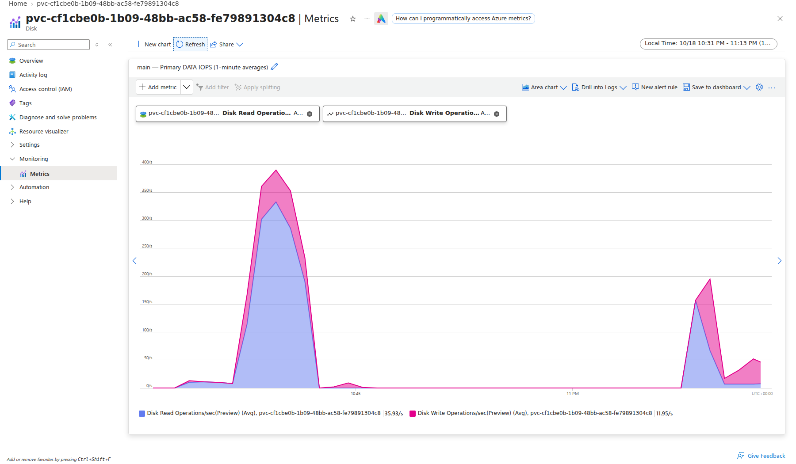

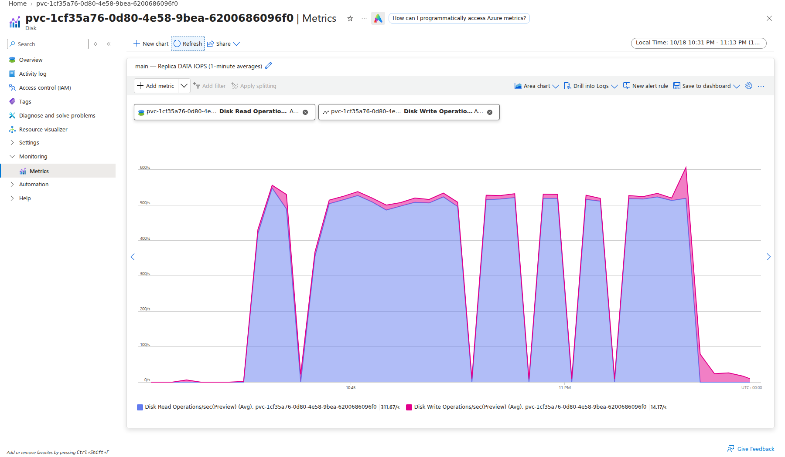


