# VM reproduction: shared DATA/WAL and dedicated WAL

Each test uses two small Azure VMs running PostgreSQL **18** from the **PGDG APT
repository**, managed by a minimal Patroni setup with one primary and one
strict synchronous standby. pgBackRest stores
a baseline full backup and archived WAL in
Azure Blob Storage. Each VM is `Standard_D2s_v6` (2 vCPUs, 8 GiB RAM)
with an uncached 64 GiB Standard HDD for DATA. By default, WAL uses a separate
uncached 32 GiB Standard HDD; `DISK_LAYOUT=shared` keeps DATA and WAL on the
64 GiB disk. Both disk sizes have the same published Standard HDD limits of
500 IOPS and 60 MB/s.

The test loads an approximately **8 GiB** pgbench table, starts ten clients at
5 TPS, runs CHECKPOINT followed by a **5% UPDATE**, then sends one SIGTERM to
the standby walreceiver **after commit and resumed writes**. Watch whether
writes wait on synchronous replication while the standby replays its backlog.

The active recipe uses Patroni with primary WAL archiving and standby archive
retrieval through pgBackRest. The [two parallel tests](#parallel-repeat-shared-and-dedicated-wal) reproduced a
**30m52s post-disconnect outage with dedicated WAL**, while shared DATA/WAL
reconnected in **0.510s** after a long UPDATE. Earlier runs show the same pattern;
their evidence remains in the [top-level README](../../README.md).

After a streaming disconnect, PostgreSQL can fetch WAL through `restore_command`
before reconnecting. Both archive push and standby archive get are required to
exercise that recovery path. [PostgreSQL standby operation](https://www.postgresql.org/docs/18/warm-standby.html#STANDBY-SERVER-OPERATION).

## Setup

Run commands from this directory (`cd vm` from the repository root). The four
scripts here are self-contained: provision the VMs, install PostgreSQL/Patroni/
pgBackRest, connect over SSH, and clean up.

Requires Bash, Python 3, curl, OpenSSH, OpenSSL, GNU `timeout`, and Azure CLI
logged in to the intended subscription. Check other experiments and reserve four
regional vCPUs per run, or eight for two concurrent runs. Give each run a
separate working directory and `.repro.env`. The provisioner checks the region's total and
`StandardDsv6Family` quotas and regional SKU restrictions.

```bash
./provision.sh                 # dedicated WAL; LOCATION=eastus by default
# Select shared DATA/WAL instead on a fresh run:
# DISK_LAYOUT=shared ./provision.sh
source .repro.env
./ssh.sh primary 'sudo -u postgres psql -X -c "SELECT version()"'
./ssh.sh primary 'sudo -u postgres patronictl -c /etc/patroni/config.yml list'
./ssh.sh primary 'sudo -u postgres psql -X -c "TABLE pg_stat_replication"'
./ssh.sh replica 'sudo -u postgres psql -X -c "TABLE pg_stat_wal_receiver"'
```

For two simultaneous tests, copy this directory to two separate run directories
before provisioning; select `DISK_LAYOUT=shared` in one and
`DISK_LAYOUT=dedicated` in the other. Each run keeps its own `.repro.env` and
SSH identity. Reserve eight regional and eight `StandardDsv6Family` vCPUs in
total before starting both runs.

SSH is allowed only from `SSH_SOURCE_CIDR` (your detected public IPv4 `/32` by
default). PostgreSQL replication uses private VM addresses. Use `./ssh.sh primary`
or `./ssh.sh replica` for an interactive shell.

The installer follows [PGDG's Ubuntu package instructions](https://www.postgresql.org/download/linux/ubuntu/)
and installs `postgresql-18`, `postgresql-client-18`, `patroni`, and `pgbackrest`
on Ubuntu 24.04. Patroni uses the packaged Python etcd client and one Ubuntu
`etcd-server` on the primary VM. This single DCS member is sufficient for the
walreceiver test; it does not provide DCS availability if the primary VM fails.
All database and DCS traffic stays on the private network.

Patroni initializes the database on the DATA disk, clones the standby, manages
its physical replication slot and synchronous standby selection, and owns the
PostgreSQL service. With dedicated WAL, both initial bootstrap and standby basebackup put WAL on
`/var/lib/postgresql-wal/18/main`, with `pg_wal` pointing to that separate disk.
The shared layout leaves `pg_wal` inside the DATA directory. The layout switch
changes disk placement only.
The configuration adds:

- Private listen addresses, local peer authentication, and the replication role/HBA entries.
- Patroni `synchronous_mode=true` and `synchronous_mode_strict=true`, so loss of
  the only synchronous standby keeps commits waiting.
- `archive_mode=on` and `archive_command` calling pgBackRest archive push.
- Standby `restore_command` calling pgBackRest archive get.

Other settings retain PostgreSQL or Patroni defaults. Patroni supplies its own
replication defaults, including `wal_keep_size=128MB` and `wal_log_hints=on`;
these differ from bare PostgreSQL defaults. Memory, checkpoints, timeouts, recovery prefetch, and
autovacuum are not tuned. PostgreSQL `synchronous_commit=on` stays at its default.
The physical slot retains WAL needed by the standby; monitor free disk space
during long tests. See [Patroni synchronous replication](https://patroni.readthedocs.io/en/latest/replication_modes.html#synchronous-mode)
and [Azure disk limits](https://learn.microsoft.com/en-us/azure/virtual-machines/disks-scalability-targets).

Provisioning creates a unique private Blob account/container in the experiment
resource group, installs pgBackRest on both VMs, validates archiving, and takes
a small full backup of the initial database. The repository credentials are
stored in a postgres-only configuration file, not `.repro.env`. The standby
continues to use streaming replication and can retrieve archived WAL during
recovery. Check backup status:

```bash
./ssh.sh primary 'sudo -u postgres pgbackrest --stanza=repro info'
```

Initialize on the primary in a detached service so a lost SSH connection does
not interrupt it:

```bash
./ssh.sh primary 'sudo bash -s' <<'SH'
systemd-run --expand-environment=no --unit=repro-init --uid=postgres \
  --property=WorkingDirectory=/var/lib/postgresql \
  --property=StandardOutput=append:/var/log/postgresql/repro-init.log \
  --property=StandardError=append:/var/log/postgresql/repro-init.log \
  /bin/bash -c '
  echo "$$" > /var/log/postgresql/repro-init.pid
  pgbench --initialize --scale=640 postgres
  rc=$?; echo "$rc" > /var/log/postgresql/repro-init.exit; exit "$rc"'
SH
./ssh.sh primary 'sudo tail -f /var/log/postgresql/repro-init.log'
```

Ctrl-C stops only the log viewer. Before proceeding, verify the exit marker is
`0`, then check replay lag:

```bash
./ssh.sh primary 'sudo cat /var/log/postgresql/repro-init.exit'
./ssh.sh primary "sudo -u postgres psql -X -c \
  'SELECT application_name, state, sync_state, pg_size_pretty(pg_current_wal_lsn() - replay_lsn) AS replay_lag FROM pg_stat_replication'"
```

Proceed when the standby is `streaming`, `sync_state` is `sync`, and replay lag
is `0 bytes`. Confirm initialization WAL has reached Blob before measurement:

```bash
./ssh.sh primary 'sudo -u postgres pgbackrest --stanza=repro check'
./ssh.sh primary "sudo -u postgres psql -X -c \
  \"SELECT count(*) AS pending_archive_segments FROM pg_ls_archive_statusdir() WHERE name LIKE '%.ready'\""
```

Wait for zero pending segments and let setup I/O settle before collecting the
baseline. `check` verifies completed WAL can be archived; the `.ready` count
also establishes whether the preceding workload's archive backlog has cleared.

## Terminal 1: run pgbench

```bash
./ssh.sh primary 'sudo bash -s' <<'SH'
systemd-run --expand-environment=no --unit=repro-pgbench --uid=postgres \
  --property=WorkingDirectory=/var/lib/postgresql \
  --property=StandardOutput=append:/var/log/postgresql/repro-pgbench.log \
  --property=StandardError=append:/var/log/postgresql/repro-pgbench.log \
  /bin/bash -c '
  pgbench --builtin=tpcb-like --no-vacuum --client=10 \
    --rate=5 --time=14400 --progress=5 --progress-timestamp postgres &
  pid=$!; echo "$pid" > /var/log/postgresql/repro-pgbench.pid
  wait "$pid"
  rc=$?; echo "$rc" > /var/log/postgresql/repro-pgbench.exit; exit "$rc"'
SH
./ssh.sh primary 'sudo tail -f /var/log/postgresql/repro-pgbench.log'
```

Wait for several healthy progress lines at approximately 5 TPS. Native progress
and errors are saved on the OS disk, independently of the SSH connection.

## Terminal 2: observe waits

```bash
./ssh.sh primary 'sudo -u postgres psql -X' <<'SQL'
SELECT pid, wait_event_type, wait_event, clock_timestamp()-xact_start AS age FROM pg_stat_activity WHERE application_name='pgbench';
\watch 1
SQL
```

## Terminal 3: observe lag

```bash
./ssh.sh primary 'sudo -u postgres psql -X' <<'SQL'
SELECT pg_size_pretty(flush_lsn - replay_lsn) AS replay_lag FROM pg_stat_replication;
\watch 1
SQL
```

The row disappears while streaming is disconnected.

## Terminal 4: write burst, then disconnect

```bash
./ssh.sh primary 'sudo bash -s' <<'SH'
systemd-run --expand-environment=no --unit=repro-update --uid=postgres \
  --property=WorkingDirectory=/var/lib/postgresql \
  --property=StandardOutput=append:/var/log/postgresql/repro-update.log \
  --property=StandardError=append:/var/log/postgresql/repro-update.log \
  /bin/bash -c '
  echo "$$" > /var/log/postgresql/repro-update.pid
  psql -X -v ON_ERROR_STOP=1 -c CHECKPOINT \
    -c "UPDATE pgbench_accounts SET abalance = abalance + 1 WHERE aid % 20 = 0"
  rc=$?; echo "$rc" > /var/log/postgresql/repro-update.exit; exit "$rc"'
SH
./ssh.sh primary 'sudo tail -f /var/log/postgresql/repro-update.log'
```

This updates **3,200,000 of 64,000,000 accounts**, spread across the table.
Wait for `UPDATE 3200000`, a native exit marker of `0`, and positive pgbench
progress **after** UPDATE commits. During UPDATE, clients may wait on row locks;
that is distinct from the post-disconnect replication wait. If SSH drops,
reconnect and inspect the log and exit marker; do not blindly retry UPDATE.

Only after those checks, send **one** SIGTERM (`kill -TERM`). Both recorded
tests used SIGTERM. SIGKILL (`kill -KILL`) was not used. The disconnect is gated
on successful UPDATE completion and resumed writes, so its elapsed time and
replay backlog can differ between layouts.

Send the signal:

```bash
./ssh.sh primary 'sudo cat /var/log/postgresql/repro-update.exit'
./ssh.sh replica 'sudo -u postgres bash -s' <<'SH'
pid=$(psql -X -Atc "SELECT pid FROM pg_stat_wal_receiver WHERE status='streaming'")
[[ $pid =~ ^[0-9]+$ ]] && kill -TERM "$pid"
SH
```

Observe repeated `0.0 tps`, growing wait ages, and `IPC / SyncRep` if the outage
occurs. Inspect the standby's native log:

```bash
./ssh.sh replica 'sudo tail -50 /var/log/postgresql/postgresql-18-main.log'
./ssh.sh replica 'sudo -u postgres psql -X -c "TABLE pg_stat_wal_receiver"'
```

Keep load running through actual streaming reconnect, replay catch-up, and
healthy TPS. Allow at least an hour for recovery if replay is progressing,
within the four-hour workload limit. Record a fast reconnect or absence of a
stall as observed; the historical 35-minute duration is not a VM expectation.

## Finish and clean up

After recovery, stop the recorded native pgbench process; keep its logs even
if an intentional stop produces no final statistics:

```bash
./ssh.sh primary 'sudo -u postgres bash -s' <<'SH'
kill -INT "$(cat /var/log/postgresql/repro-pgbench.pid)"
SH
```

Check the exit marker with short reads. If SIGINT is ignored for 30 seconds,
send SIGTERM to that same PID and reconcile its exit marker. Save native logs
before deletion (a local directory outside the repository works):

```bash
mkdir -p "$HOME/walreceiver-logs/$RG"
for name in init update pgbench; do
  ./ssh.sh primary "sudo cat /var/log/postgresql/repro-$name.log" > "$HOME/walreceiver-logs/$RG/$name.log"
  ./ssh.sh primary "sudo cat /var/log/postgresql/repro-$name.exit" > "$HOME/walreceiver-logs/$RG/$name.exit"
done
./ssh.sh replica 'sudo cat /var/log/postgresql/postgresql-18-main.log' > "$HOME/walreceiver-logs/$RG/replica.log"
./cleanup.sh
```

**Clean up immediately after the test or a failed attempt.** The cleanup script
deletes the unique resource group (both VMs, their disks, network, and public
IPs, and the Blob account including all backups and archived WAL), then verifies absence. It keeps local run state if deletion fails so it
can be retried. Provisioning errors also trigger cleanup. There is no managed
node group in this version.

## Parallel repeat: shared and dedicated WAL

Two fresh main tests ran concurrently on **2026-10-25**, each on its own pair
of `Standard_D2s_v6` VMs in East US. Both installed PostgreSQL **18.6**,
Patroni **4.1.5**, and pgBackRest **2.59.3** from PGDG on Ubuntu 24.04.5.
The shared run used one uncached 64 GiB Standard HDD per VM; the dedicated run
added an uncached 32 GiB WAL disk per VM. Device identities were verified before
loading data. The 61 audited PostgreSQL settings matched between layouts.
Both retained strict synchronous replication, PostgreSQL/Patroni defaults,
and pgBackRest Azure Blob backup, archive push, and standby archive get.

Both runs used **SIGTERM**, not SIGKILL. Signal times below come from the
walreceiver's native termination log; UPDATE completion is bounded by the
successful native service exit. All times are **2026-10-25 UTC**.

| Event | Shared DATA/WAL | Dedicated WAL |
| --- | --- | --- |
| pgbench start (approx.) | 18:00:40 | 18:00:40 |
| UPDATE query start | 18:01:53.436 | 18:02:08.869 |
| UPDATE service completed (approx.) | 18:39:44.928 | 18:06:19.472 |
| Walreceiver SIGTERM | **18:40:22.968** | **18:07:01.948** |
| Completion → SIGTERM | about 38.0s | about 42.5s |
| Streaming reconnected | 18:40:23.478 | 18:37:54.038 |

**These are disconnects after each UPDATE completed and writes resumed.**
They are not disconnects at equal elapsed time or equal replay backlog. The
shared run had nearly caught up before its signal; the dedicated-WAL run still
had a large replay backlog.

Both used scale 640, ten clients at 5 TPS, CHECKPOINT + a 3,200,000-row UPDATE,
and one walreceiver SIGTERM after successful UPDATE completion and full positive
pgbench intervals. Native pgbench started at approximately **18:00:40 UTC** in
both runs. Both UPDATEs exited `0`; both baseline full backups completed and the
archive push/get checksum checks passed. Final replay lag was zero. Both archives had zero failures and zero pending completed segments. Patroni strict mode and `synchronous_commit=on`
remained enabled throughout.

| Layout | Approx. UPDATE duration | Maximum flush-to-replay gap | SIGTERM → streaming reconnect | Full zero-TPS buckets after SIGTERM |
| --- | ---: | ---: | ---: | ---: |
| Shared DATA/WAL | 37m51s | 23.8 MiB | **0.510s** | **0** |
| Dedicated WAL | 4m11s | 8.77 GiB | **30m52.090s** | **369 × 5s = 30m45s** |

UPDATE duration uses the observed SQL query start and native successful systemd
service completion, which bounds SQL completion from above. The later observer
reads were preserved separately. Reconnect times come from native PostgreSQL
logs. The first positive reporting interval can straddle reconnect; its bucket
end does not establish the exact first completed transaction time.

This repeats the earlier layout-dependent result: the sustained post-disconnect
outage occurred with dedicated WAL. Shared DATA/WAL instead had **444** zero-TPS
buckets overlapping the long UPDATE, intermittently; the dedicated run had
**20** during its UPDATE. Dedicated WAL received/flushed far ahead of replay:
the last pre-signal sample, 9.5 seconds before SIGTERM, showed **8.66 GiB** of
flush-to-replay backlog. Shared DATA/WAL had only about **26 KiB** in its last
pre-signal primary sample and zero receiver-to-replay gap in the replica sample.

Read-only Linux disk counters over **18:20:19–18:21:28 UTC** showed substantial
replica DATA I/O pressure. Shared was still in UPDATE; dedicated was replaying
after disconnect. These are block-layer measurements from those phases, not a
measured I/O amplification factor or proof of causality.

| Replica layout | DATA reads/s | DATA writes/s | DATA busy time | Average I/O queue | Mean read completion |
| --- | ---: | ---: | ---: | ---: | ---: |
| Shared DATA/WAL | 484.8 | 50.7 | 99.86% | 176.7 | 350.1ms |
| Dedicated WAL | 522.4 | 25.4 | 99.99% | 95.5 | 178.8ms |

Reads averaged about 8 KiB each, only 3.8–4.1 MiB/s despite the high IOPS.
The observations are consistent with DATA replay I/O limiting catch-up while
separate WAL storage lets receive/flush run ahead. They do not establish that a
separate WAL disk always causes this behavior.

### Shared DATA/WAL repeat

UPDATE query start was **18:01:53.436 UTC**; its native service completed at
approximately **18:39:44.928 UTC**. After resumed writes, SIGTERM occurred at
**18:40:22.968**, and streaming reconnected at **18:40:23.478 UTC**. No full
post-signal zero-TPS bucket or additional archive-restored WAL file was observed.
The first post-reconnect bucket ended at **18:40:26.197 UTC**, at **144.6 TPS**,
and straddled signal/reconnect. Final archiver count was **1,148**, with zero
failures and no pending completed WAL segments.

The native log contains **504** progress buckets without missing intervals.
The bounded client stop ended with native exit `143`, without an optional final
statistics block; complete stdout/stderr and exit markers were retained.

Resource group `rg-walreceiver-20261025-174442-30408`, including both VMs,
all disks and Blob backups, was deleted; absence was independently verified at
**2026-10-25T18:52:20.471Z**. Pre-existing Network Watchers were preserved.

Chart window: **2026-10-25 17:59–18:43 UTC**. Azure charts use one-minute
averages; TPS retains native five-second intervals with the axis fixed at 0–10
and larger values clipped. **Azure returned no metric series for the shared
replica DATA disk**, in both Portal and API throughout the window. Its actual
Portal view is retained below: `--` legends and a flat line do not establish
zero IOPS. The Linux counter evidence above confirms that device was busy.

Before SIGTERM, resumed writes show brief I/O waits:

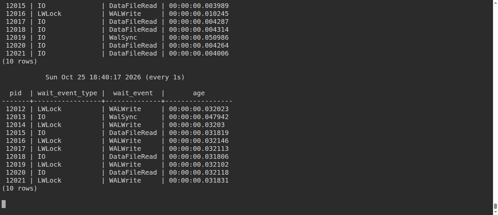

After the brief disconnect, all ten sessions were back on `ClientRead` by 18:41:06:

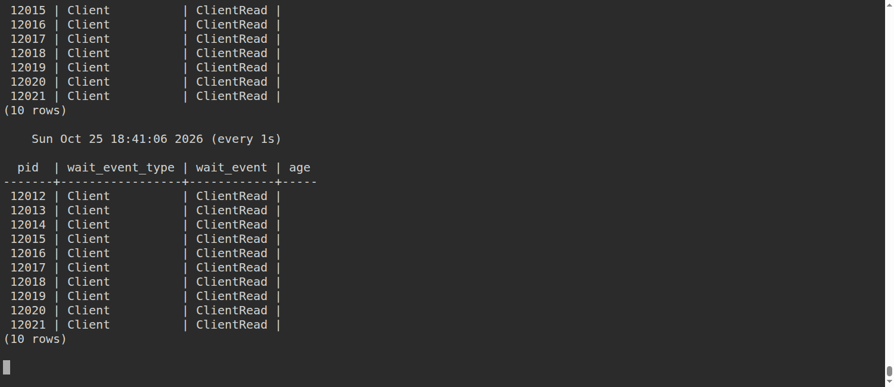

Streaming reconnected at approximately **18:40:23.478 UTC**; capture time is 18:40:34:

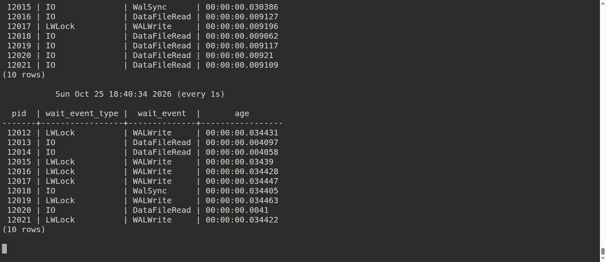

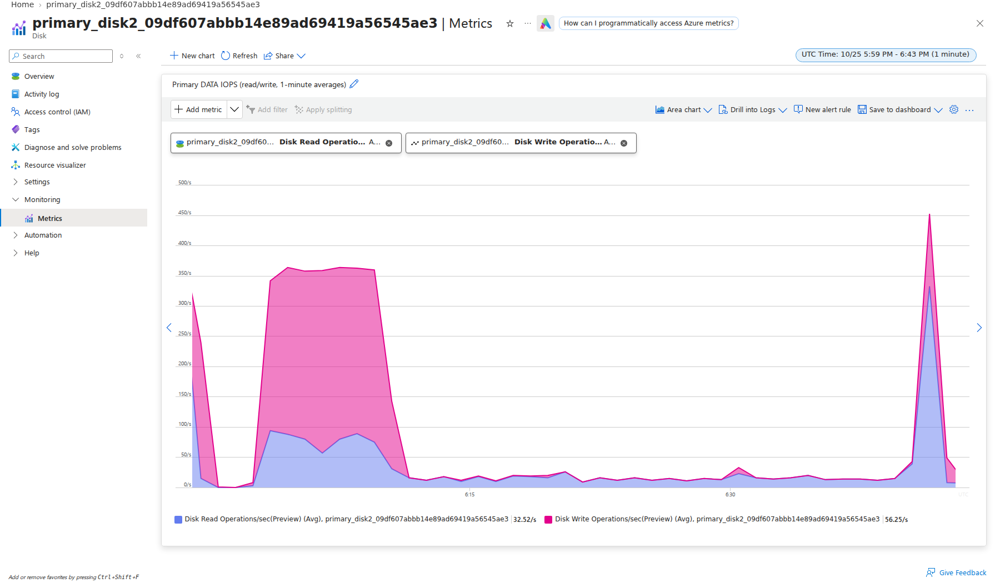

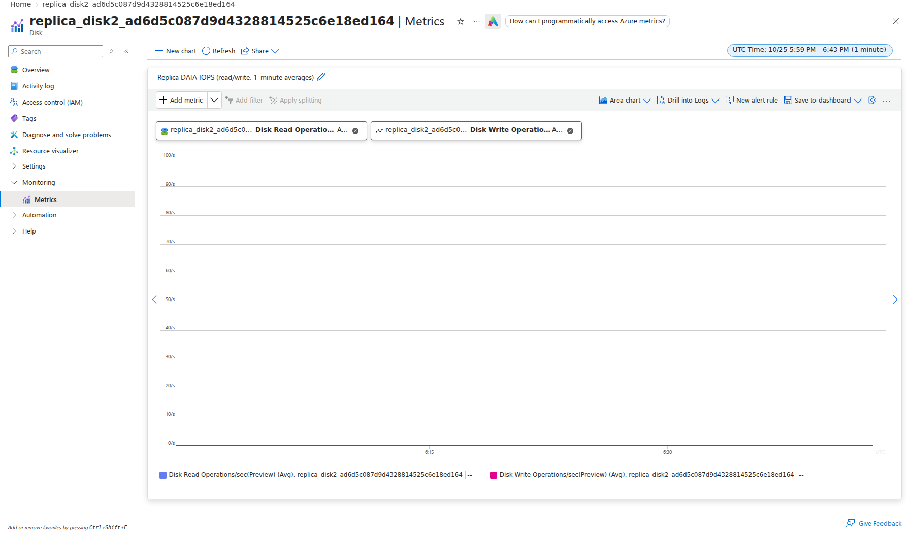

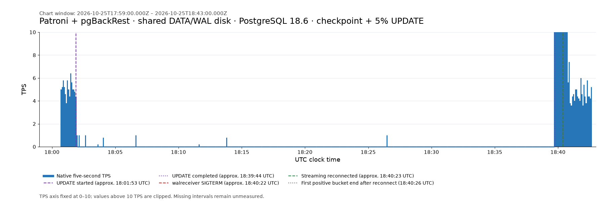

### Dedicated WAL repeat

UPDATE query start was **18:02:08.869 UTC**; its native service completed at
approximately **18:06:19.472 UTC**. SIGTERM occurred at **18:07:01.948**;
streaming reconnected at **18:37:54.038 UTC**, **30m52.090s** later.
The **369** full zero-TPS buckets span **18:07:06.137–18:37:51.140 UTC**.
All **131 sampled outage snapshots** showed ten clients waiting on `IPC/SyncRep`.
The first positive bucket ended at **18:37:56.136 UTC**, at **151.7 TPS**,
and straddled reconnect. The replica logged **550** additional successful WAL-restore messages.

Patroni changed `synchronous_standby_names` from `replica` to `*` while the
receiver was absent and back to `replica` after reconnect; strict acknowledgement
remained required. Final archiver count was **1,147**, with zero failures and
no pending completed WAL segments. The native log contains **474** progress
buckets without missing intervals. The bounded client stop ended with native
exit `143` and no optional final statistics block; full logs were retained.

Resource group `rg-walreceiver-20261025-174443-16195`, including both VMs,
all DATA/WAL disks and Blob backups, was deleted; absence was independently
verified at **2026-10-25T18:50:49.787Z**. Pre-existing Network Watchers were preserved.

Chart window: **2026-10-25 17:59–18:41 UTC**. Azure charts use one-minute
averages; TPS retains native five-second intervals, with the axis fixed at
0–10 and larger values clipped. Both DATA Portal charts contain stacked read/write
areas, numeric legends, and the complete recovery window.

Healthy writes before SIGTERM:


All ten clients waiting on `SyncRep` about 38 seconds after SIGTERM:

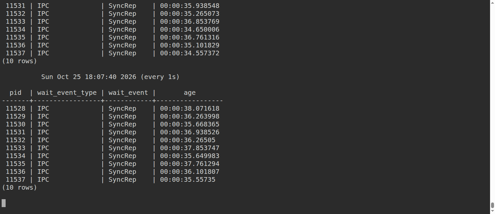

Streaming reconnected at approximately **18:37:54.038 UTC**; capture time is 18:38:07:

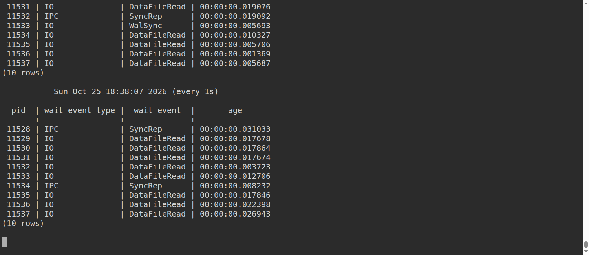

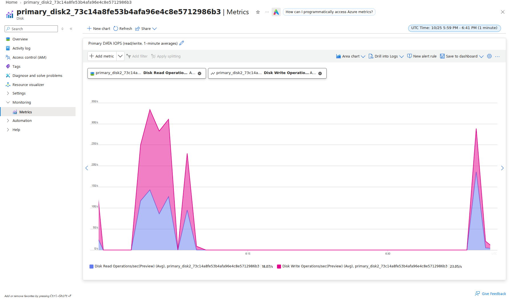

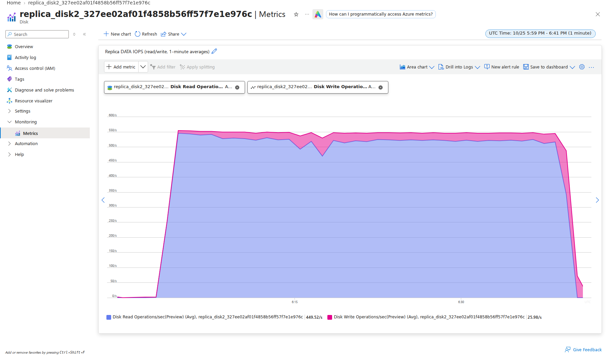

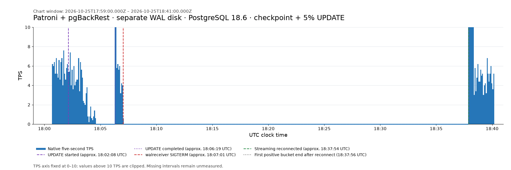
