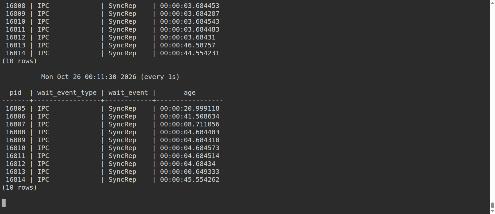
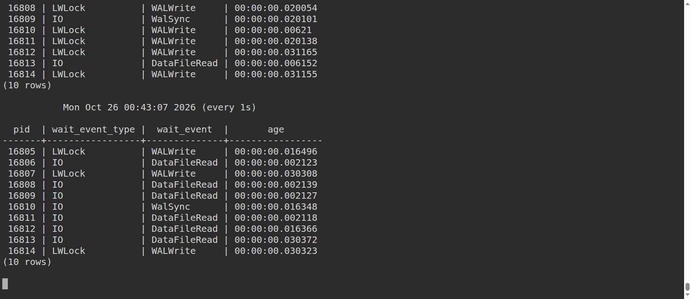
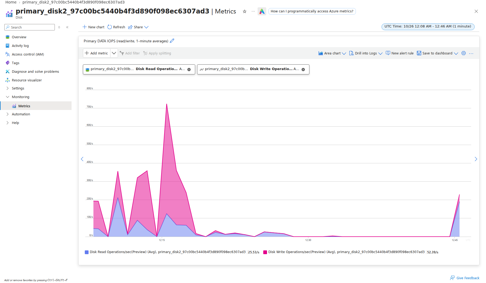
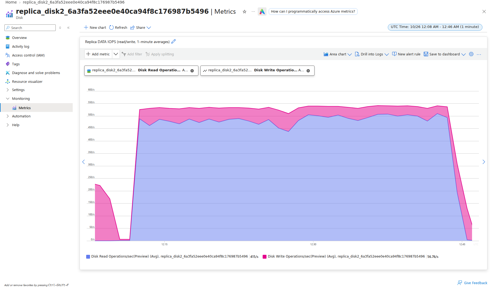
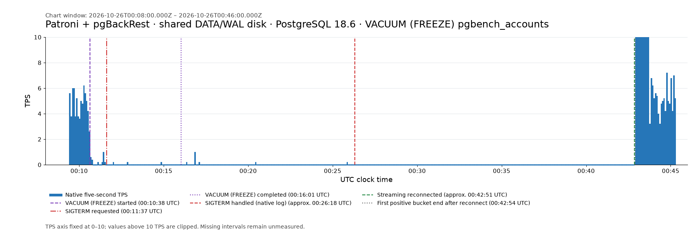
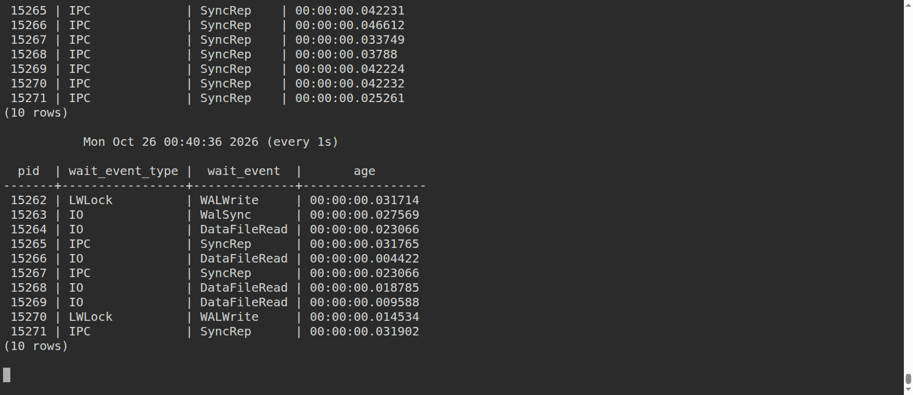
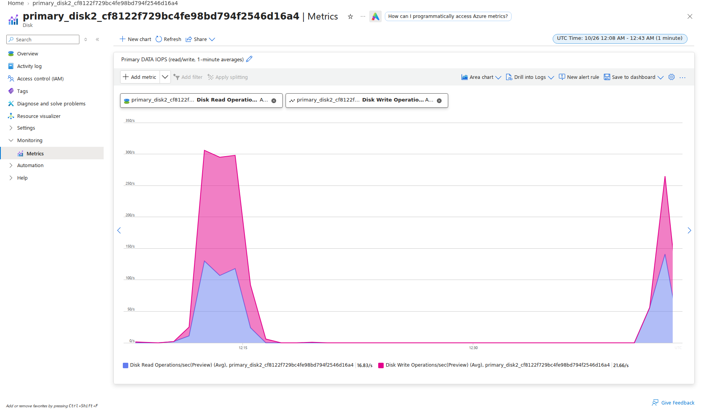
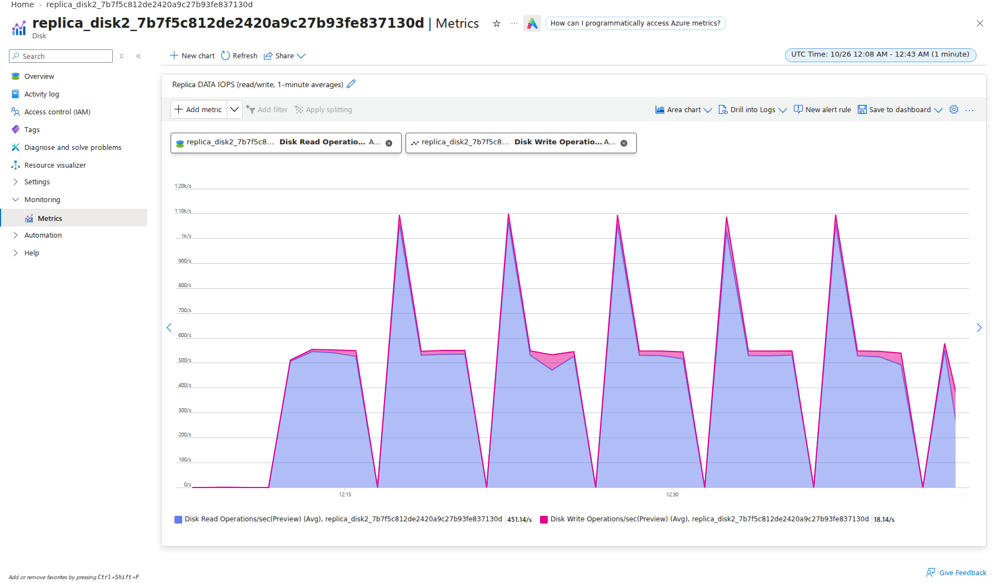
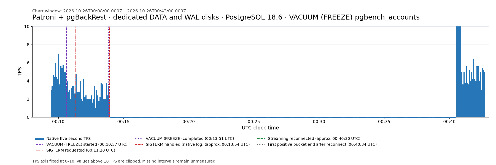

# VM reproduction: VACUUM and synchronous replication

This recipe prepares two matched tests of a PostgreSQL 18 primary and strict
synchronous standby. Both use PGDG packages, Patroni, and pgBackRest with Azure
Blob backup, archive push, and standby archive retrieval. The tests differ only
in disk layout:

| Run | DATA | WAL |
| --- | --- | --- |
| Shared | One uncached 64 GiB Standard HDD per VM | Same disk as DATA |
| Dedicated | One uncached 64 GiB Standard HDD per VM | Separate uncached 32 GiB Standard HDD |

Each run has its own pair of `Standard_D2s_v6` Ubuntu VMs. Both use pgbench
scale 640, ten clients, and a 5 TPS offered rate. The operation is CHECKPOINT
followed by `VACUUM (FREEZE) pgbench_accounts`; initialization leaves the
accounts unfrozen so FREEZE has work to perform. Keep PostgreSQL and Patroni
defaults apart from the connection, authentication, standby, slot, and strict
synchronous settings required by the reproduction. Do not tune memory,
checkpoints, timeouts, recovery prefetch, or autovacuum.

The current VM tests send one SIGTERM to the standby walreceiver while
`VACUUM (FREEZE)` progress is active, when the primary's current WAL flush
position is at least 512 MiB ahead of replica replay and pgbench is still
making healthy, positive progress. The gate is
`pg_wal_lsn_diff(pg_current_wal_flush_lsn(), replay_lsn) >= 536870912` bytes.
This measures the primary flush position to replica replay. It is distinct
from `pg_stat_replication.flush_lsn - replay_lsn`, which measures the
replica-reported flush position to replay, and from the primary WAL insertion
position to replay. The retained historical AKS VACUUM runner used the same
primary-flush-to-replay formula. Send the one-shot signal only while VACUUM
progress is active and pgbench continues to make positive progress. Keep
pgbench running afterward until native VACUUM completion, streaming reconnect,
replay catch-up, and healthy progress are all observed. Historical AKS evidence
remains separate and does not count as VM results.

## Prepare the two isolated runs

Use separate working directories for the shared and dedicated runs. Each must
have its own `.repro.env`, SSH key, native logs, event record, and resource
group. Reserve eight total and eight `StandardDsv6Family` vCPUs centrally
before either provisioner starts.
Record the existing Network Watchers. Use the same location and fresh shared
preflight evidence for both runs.

Copy this directory once per run, then provision each from its own directory:

```bash
cp -a vm/vacuum /path/to/run-shared
cp -a vm/vacuum /path/to/run-wal
cd /path/to/run-shared
PREFLIGHT_EVIDENCE=/absolute/path/preflight.json DISK_LAYOUT=shared LOCATION=eastus ./provision.sh
```

In the other terminal, run the dedicated layout with the same evidence and
location:

```bash
cd /path/to/run-wal
PREFLIGHT_EVIDENCE=/absolute/path/preflight.json DISK_LAYOUT=dedicated LOCATION=eastus ./provision.sh
```

The provisioner checks total and `StandardDsv6Family` quotas, rejects regional
SKU restrictions, and deploys asynchronously. It installs PGDG PostgreSQL 18,
Patroni, pgBackRest, and a single etcd DCS member on the primary. Each run gets
its own private Azure Blob account and backup container. The one-member DCS is
sufficient for this walreceiver test but does not provide DCS availability if
the primary VM fails.

After provisioning, source that run's environment and check versions, Patroni,
and replication:

```bash
source .repro.env
./ssh.sh primary 'sudo -u postgres psql -X -c "SELECT version()"'
./ssh.sh primary 'sudo -u postgres patronictl -c /etc/patroni/config.yml list'
./ssh.sh primary 'sudo -u postgres psql -X -c "TABLE pg_stat_replication"'
./ssh.sh replica 'sudo -u postgres psql -X -c "TABLE pg_stat_wal_receiver"'
./ssh.sh primary 'sudo -u postgres pgbackrest --stanza=repro info'
```

PostgreSQL traffic uses the private VM addresses. SSH is limited to
`SSH_SOURCE_CIDR` (the detected public IPv4 `/32` by default). PostgreSQL
`synchronous_commit=on` remains at its default. Patroni enables
`synchronous_mode` and `synchronous_mode_strict`, uses a physical replication
slot, and manages the synchronous standby. It supplies replication defaults
such as `wal_keep_size=128MB` and `wal_log_hints=on`; report these as Patroni
defaults rather than bare PostgreSQL defaults.

## Verify disk placement before loading data

Use Azure's current managed-disk IDs and LUNs for each VM; do not infer identity
from an older run:

```bash
source .repro.env
az vm show -g "$RG" -n primary --query 'storageProfile.dataDisks[].{name:name,id:managedDisk.id,lun:lun,sizeGiB:diskSizeGB,caching:caching}'
az vm show -g "$RG" -n replica --query 'storageProfile.dataDisks[].{name:name,id:managedDisk.id,lun:lun,sizeGiB:diskSizeGB,caching:caching}'
```

Check mounts on both VMs before pgbench initialization. DATA must be distinct
from the OS disk. In the shared run DATA and `pg_wal` resolve to the same
device; in the dedicated run they must resolve to different devices:

```bash
for role in primary replica; do
  ./ssh.sh "$role" 'sudo readlink -e /var/lib/postgresql/18/main; sudo readlink -e /var/lib/postgresql/18/main/pg_wal; sudo findmnt --target /var/lib/postgresql/18/main; sudo findmnt --target /var/lib/postgresql/18/main/pg_wal'
done
```

The dedicated layout places `pg_wal` on `/var/lib/postgresql-wal/18/main`.
The shared layout keeps it under `/var/lib/postgresql/18/main`. The installer
checks the dedicated relationship before starting Patroni; independently
record the device relationship for both layouts before loading the benchmark.

## Initialize and start pgbench

Initialize on the primary as a detached systemd service. `--init-steps=dtGp`
creates the pgbench tables and data without the default vacuum/freeze step, so
the measured `VACUUM (FREEZE)` processes unfrozen rows. This is a workload
initialization choice, not a PostgreSQL GUC change. The native output, PID, and
exit marker are stored on the OS disk under
`/var/log/postgresql/repro-*`:

```bash
./ssh.sh primary 'sudo bash -s' <<'SH'
systemd-run --expand-environment=no --unit=repro-init --uid=postgres \
  --property=WorkingDirectory=/var/lib/postgresql \
  --property=StandardOutput=append:/var/log/postgresql/repro-init.log \
  --property=StandardError=append:/var/log/postgresql/repro-init.log \
  /bin/bash -c '
  echo "$$" > /var/log/postgresql/repro-init.pid
  pgbench --initialize --scale=640 --init-steps=dtGp postgres
  rc=$?; echo "$rc" > /var/log/postgresql/repro-init.exit; exit "$rc"'
SH
./ssh.sh primary 'sudo tail -f /var/log/postgresql/repro-init.log'
```

Ctrl-C stops only the log viewer. Before continuing, require exit marker `0`,
`state=streaming`, `sync_state=sync`, and zero replay lag. Confirm archive
operation and that no completed WAL segments remain pending:

```bash
./ssh.sh primary 'sudo cat /var/log/postgresql/repro-init.exit'
./ssh.sh primary "sudo -u postgres psql -X -c \
  'SELECT application_name, state, sync_state, pg_size_pretty(pg_current_wal_lsn() - replay_lsn) AS replay_lag FROM pg_stat_replication'"
./ssh.sh primary 'sudo -u postgres pgbackrest --stanza=repro check'
./ssh.sh primary "sudo -u postgres psql -X -c \
  \"SELECT count(*) AS pending_archive_segments FROM pg_ls_archive_statusdir() WHERE name LIKE '%.ready'\""
```

Wait for initialization-triggered autovacuum to finish, zero pending archive
segments, and replay catch-up so setup I/O has settled. Leave autovacuum at its
default settings. Then start
pgbench in a detached service. Keep its complete native stdout/stderr and exit
marker even if the SSH viewer disconnects:

```bash
./ssh.sh primary 'sudo bash -s' <<'SH'
systemd-run --expand-environment=no --unit=repro-pgbench --uid=postgres \
  --property=WorkingDirectory=/var/lib/postgresql \
  --property=StandardOutput=append:/var/log/postgresql/repro-pgbench.log \
  --property=StandardError=append:/var/log/postgresql/repro-pgbench.log \
  /bin/bash -c '
  pgbench --builtin=tpcb-like --no-vacuum --client=10 \
    --rate=5 --time=14400 --progress=5 --progress-timestamp postgres &
  pid=$!; echo "$pid" > /var/log/postgresql/repro-pgbench.pid
  wait "$pid"
  rc=$?; echo "$rc" > /var/log/postgresql/repro-pgbench.exit; exit "$rc"'
SH
./ssh.sh primary 'sudo tail -f /var/log/postgresql/repro-pgbench.log'
```

Wait for several healthy positive progress lines. Keep offered load running
through VACUUM, the walreceiver event, actual streaming reconnect, replay
catch-up, and healthy TPS.

## Observe waits and run VACUUM

Observe pgbench wait events in a second terminal. Prolonged `SyncRep` waits
alongside repeated zero-TPS progress lines identify a synchronous-replication
stall. Record a fast reconnect or absence of a stall honestly.

```bash
./ssh.sh primary 'sudo -u postgres psql -X' <<'SQL'
SELECT pid, wait_event_type, wait_event, clock_timestamp()-xact_start AS age
FROM pg_stat_activity WHERE application_name='pgbench';
\watch 1
SQL
```

The query start comes from `pg_stat_activity.query_start`. Run CHECKPOINT
followed by `VACUUM (FREEZE)` in a detached service named `repro-vacuum`, with
its log, PID, and exit marker on the OS disk. This keeps the operation
independent of the SSH viewer:

```bash
./ssh.sh primary 'sudo bash -s' <<'SH'
systemd-run --expand-environment=no --unit=repro-vacuum --uid=postgres \
  --property=WorkingDirectory=/var/lib/postgresql \
  --property=StandardOutput=append:/var/log/postgresql/repro-vacuum.log \
  --property=StandardError=append:/var/log/postgresql/repro-vacuum.log \
  /bin/bash -c '
  echo "$$" > /var/log/postgresql/repro-vacuum.pid
  psql -X -v ON_ERROR_STOP=1 -c CHECKPOINT \
    -c "VACUUM (FREEZE) pgbench_accounts"
  rc=$?; echo "$rc" > /var/log/postgresql/repro-vacuum.exit; exit "$rc"'
SH
./ssh.sh primary 'sudo tail -f /var/log/postgresql/repro-vacuum.log'
```

Before triggering the walreceiver signal, verify in Terminal 2 that the
`pg_stat_progress_vacuum` row for `pgbench_accounts` is active, the replica is
streaming and synchronous, and the primary's current WAL flush position is at
least 512 MiB ahead of replica replay. The threshold is
`pg_wal_lsn_diff(pg_current_wal_flush_lsn(), replay_lsn) >= 536870912` bytes.
The replica's reported `flush_lsn - replay_lsn` and primary's
`pg_current_wal_lsn() - replay_lsn` are recorded as separate diagnostic
distances; neither defines this signal gate. Wait for a positive timestamped
pgbench progress bucket while all ten pgbench clients are present and VACUUM
progress and the gate are both active, then confirm the latest gate row is
still true before sending the signal. Do not send it after VACUUM has completed
or if the gate, all ten clients, and positive progress do not coincide.

```bash
./ssh.sh primary 'sudo -u postgres psql -X -P pager=off' <<'SQL'
WITH active_operation AS (
  SELECT a.query_start, v.phase
  FROM pg_stat_activity AS a
  JOIN pg_stat_progress_vacuum AS v ON v.pid=a.pid
  WHERE a.datname=current_database() AND a.state='active'
    AND a.query ILIKE 'VACUUM%pgbench_accounts%'
    AND v.datname=current_database()
    AND v.relid='pgbench_accounts'::regclass
  ORDER BY a.query_start DESC
  LIMIT 1
), replication AS (
  SELECT r.application_name, r.state, r.sync_state,
         r.flush_lsn AS replica_reported_flush_lsn,
         r.replay_lsn,
         pg_current_wal_flush_lsn() AS primary_current_flush_lsn,
         pg_wal_lsn_diff(pg_current_wal_flush_lsn(),r.replay_lsn)::bigint
           AS primary_flush_to_replay_bytes,
         pg_wal_lsn_diff(r.flush_lsn,r.replay_lsn)::bigint
           AS replica_reported_flush_to_replay_bytes,
         pg_wal_lsn_diff(pg_current_wal_lsn(),r.replay_lsn)::bigint
           AS primary_wal_to_replay_bytes
  FROM pg_stat_replication AS r
  WHERE r.application_name='replica'
)
SELECT clock_timestamp() AS sampled_at_utc,
       a.query_start AS vacuum_query_start, a.phase AS vacuum_phase,
       (a.query_start IS NOT NULL) AS vacuum_progress_active,
       r.application_name, r.state, r.sync_state,
       r.primary_current_flush_lsn, r.replica_reported_flush_lsn, r.replay_lsn,
       r.primary_flush_to_replay_bytes,
       pg_size_pretty(r.primary_flush_to_replay_bytes) AS primary_flush_to_replay,
       r.replica_reported_flush_to_replay_bytes,
       r.primary_wal_to_replay_bytes,
       (a.query_start IS NOT NULL AND r.state='streaming' AND r.sync_state='sync'
        AND r.replay_lsn IS NOT NULL
        AND r.primary_flush_to_replay_bytes >= 536870912) AS signal_gate_ready
FROM replication AS r LEFT JOIN active_operation AS a ON true;
\watch 1
SQL
```

When the gate is true, all ten pgbench clients are present, and a recent
completed five-second pgbench bucket has positive TPS, confirm the latest gate
row is still true and VACUUM remains active. If any condition has changed, do
not signal; wait for all three to hold again while VACUUM is active. Then send
exactly one SIGTERM to the replica's current streaming walreceiver PID:

```bash
./ssh.sh replica 'sudo -u postgres bash -s' <<'SH'
set -euo pipefail
pid=$(psql -X -Atc "SELECT pid FROM pg_stat_wal_receiver WHERE status='streaming'")
[[ $pid =~ ^[0-9]+$ ]] || { echo "Expected one streaming walreceiver PID; found: $pid" >&2; exit 1; }
printf 'walreceiver PID: %s\nSIGTERM requested UTC: ' "$pid"
date -u --iso-8601=ns
kill -TERM "$pid"
SH
```

This is a one-shot command. If SSH disconnects while it runs, do not rerun it;
reconcile the native PostgreSQL log, receiver PID/status, and signal evidence.
Record the request time separately from the matching walreceiver termination
log: PostgreSQL can defer termination while processing WAL. A successful
`kill` command alone does not establish when streaming disconnected.
Keep offered load running while VACUUM completes and WAL streaming reconnects.
The two events can occur in either order. Require both native `repro-vacuum`
exit marker `0` with successful `VACUUM` output and actual streaming reconnect
before declaring recovery complete; then continue through replay catch-up and
healthy TPS. If VACUUM exits before the signal gate and healthy progress
coincide, do not send a late signal; preserve and report the run as a condition
not met.

Observe actual waits, native walreceiver termination, and streaming reconnect.
Record whether a sustained zero-TPS interval occurred; report no outage when
none occurred. Do not infer exact transaction timing from a five-second
reporting bucket: pgbench's first positive bucket marks the reporting
interval's end and may overlap reconnect.

## Finish and clean up

After healthy recovery, stop the recorded native pgbench process with SIGINT.
If it ignores SIGINT for 30 seconds, use bounded SIGTERM on that same PID and
reconcile its exit marker. A missing optional final statistics block after an
intentional stop does not invalidate retained native progress and exit data.
Save native logs and exit markers before cleanup, including the primary
PostgreSQL log and the replica PostgreSQL log.

Complete and review each run's evidence before deleting its resources. Clean up
each layout independently as soon as its evidence is complete:

```bash
./cleanup.sh
```

Verify that run's unique resource group is absent, including both VMs, all
managed disks, network resources, and the pgBackRest Blob account and backups.
Keep local evidence and environment state if deletion fails so cleanup can be
retried. Preserve pre-existing Network Watchers and unrelated resources. Do
not leave a healthy or failed experiment running after reconciliation is
complete.

## Results: parallel VACUUM runs

Both layouts reproduced prolonged streaming interruption, archive replay, and
zero-TPS periods under strict synchronous replication. The result was not
limited to the dedicated-WAL layout. Actual signal handling occurred at
different times, so the outage durations are not an isolated measure of disk
layout alone.

Both fresh VM layouts completed the requested `CHECKPOINT` followed by
`VACUUM (FREEZE) pgbench_accounts`, with one walreceiver SIGTERM requested in
each run while VACUUM progress was active. Both gates used the primary's
current WAL flush position to replica replay:
`pg_wal_lsn_diff(pg_current_wal_flush_lsn(), replay_lsn) >= 536870912`.
The replica-reported `flush_lsn - replay_lsn` values below are separate
diagnostics, not the trigger. Each request had ten healthy pgbench sessions and
a positive bucket after the healthy terminal capture. In both runs, PostgreSQL
handled the signal after the successful VACUUM unit completion, so request-time
gate confirmation and the later native walreceiver FATAL are reported as
distinct events.

The runs used two `Standard_D2s_v6` VMs each, PGDG PostgreSQL 18.6, Patroni
4.1.5, and pgBackRest 2.59.3. Both used pgbench scale 640, ten clients, and a
5 TPS offered rate. Patroni strict synchronous mode remained enabled;
`synchronous_commit=on` retained its default source. No memory, checkpoint,
timeout, recovery-prefetch, or autovacuum tuning was added. Initialization used
`--init-steps=dtGp` so `VACUUM (FREEZE)` had unfrozen rows to process.

All timestamps below are UTC on 2026-10-26. VACUUM duration is measured from
`pg_stat_activity.query_start` to successful native service completion. The
systemd unit begins earlier because it runs `CHECKPOINT` first.
Native FATAL and streaming reconnect times are approximate UTC times from the
replica PostgreSQL log.

| Event | Shared DATA/WAL | Dedicated WAL |
| --- | --- | --- |
| VACUUM query start | 00:10:38.210690 | 00:10:37.174515 |
| Native `repro-vacuum` unit start → successful exit | 00:10:35.641200 → 00:16:01.957885; 326.317 s | 00:10:35.464468 → 00:13:51.022120; 195.558 s |
| VACUUM query duration; exit marker | 323.747 s; `0` | 193.848 s; `0` |
| Healthy capture → positive bucket before request | 00:11:31.089 → 00:11:34.383; 0.2 TPS | 00:11:14.496 → 00:11:19.349; 2.6 TPS |
| SIGTERM request and gate evidence | 00:11:37.234; active activity/progress PID 17784; primary flush→replay 1,559,463,416 B (1.452 GiB); replica flush→replay 16,781,784 B (16.004 MiB) | 00:11:20.468; active activity/progress PID 16243; primary flush→replay 1,794,808,024 B (1.672 GiB); replica flush→replay 1,695,060,560 B (1.579 GiB) |
| Native walreceiver FATAL | 00:26:18.687; 881.453 s after request and 616.729 s after VACUUM completion | 00:13:54.704; 154.236 s after request and 3.682 s after VACUUM completion |
| Native streaming reconnect; Patroni sync reconfirmed | 00:42:51.376; 16m32.689s after FATAL; sync reconfirmed 00:43:11.293 | 00:40:30.560; 26m35.856s after FATAL; sync reconfirmed 00:40:39.927 |
| First positive bucket after reconnect | 00:42:54.379; 0.2 TPS | 00:40:34.348; 262.5 TPS |

The post-reconnect positive buckets straddle their reconnect times. Their end
timestamps mark five-second reporting interval boundaries and do not identify
the exact first completed transaction. Shared DATA/WAL had 56 zero-TPS buckets
overlapping VACUUM, for 277.575 seconds of measured zero progress. After its
native FATAL, a 199-bucket zero run extended from 00:26:14.383 to 00:42:49.383;
the first bucket straddled FATAL by 0.696 seconds, followed by 198 full
five-second zero buckets (990 seconds). Dedicated WAL had no zero-TPS buckets
overlapping VACUUM. A 2-TPS bucket ending at 00:13:59.352 straddled its native
FATAL; it was followed by 318 full zero buckets from 00:13:59.353 through
00:40:29.349 (1,590 seconds). Sampled primary waits showed all ten sessions in
`IPC/SyncRep` in 64/64 shared and 78/78 dedicated-WAL observations between
native FATAL and reconnect; these are discrete samples, not continuous
coverage. Pgbench reported zero failed transactions in its progress buckets.
Both native VACUUM units exited successfully. Pgbench ran through catch-up and
healthy recovery; its intentional, bounded SIGINT-to-SIGTERM stop produced exit
143 without an optional final statistics block. Complete native progress and
exit markers were preserved. Local observers were restarted during recovery;
the native workload and timestamped progress continued without missing buckets.

The `pgbench_accounts` `relallfrozen` value changed from 0 before VACUUM to
1,048,799 after it in the shared run and 1,048,304 in the dedicated-WAL run.
Replica PostgreSQL logs reported 272 restored archive WAL files after native
FATAL for shared (271 distinct segment IDs) and 462 for dedicated WAL. No
`synchronous_standby_names` relaxation event occurred. During recovery the
setting briefly became `*` before returning to `replica`, while Patroni's strict
synchronous mode remained true and `synchronous_commit` remained `on`.

Linux block-layer DATA diskstats recorded these read totals. The after snapshots
extend slightly beyond the plotted chart windows and include a short idle tail
after pgbench stopped. They are not Azure Portal metrics.

| Layout | Primary DATA reads | Replica DATA reads | Diskstats interval, approximately |
| --- | --- | --- | --- |
| Shared DATA/WAL | 48,689 requests; 7.101 GiB | 947,310 requests; 7.230 GiB | 00:09:00–00:47:07 |
| Dedicated WAL | 36,105 requests; 4.656 GiB | 948,428 requests; 7.239 GiB | 00:09:00–00:43:40 |

Between the mid-1 and mid-2 Linux blockstats snapshots, replica DATA read rates
were 483.3 IOPS for shared and 535.7 IOPS for dedicated WAL, at about 8.01 KiB
per request. The block-layer `io_ms` utilization was 99.9% and 100.0%,
respectively. For the same interval, shared primary DATA/WAL was 15.1 read
IOPS at about 255 KiB per request, and dedicated-WAL primary DATA had no read
requests. These observed counters do not establish cause or I/O amplification;
the Linux block layer, PostgreSQL `pg_stat_io`, and Portal metrics have
different scopes.

### Shared DATA/WAL layout

Azure Portal DATA charts use the same custom UTC window, 2026-10-26
00:08–00:46. The Linux blockstats collection interval is listed above.




Approximate native streaming reconnect: 2026-10-26 00:42:51 UTC.









### Dedicated WAL layout

Azure Portal DATA charts use the same custom UTC window, 2026-10-26
00:08–00:43. The Linux blockstats collection interval is listed above.


Approximate native streaming reconnect: 2026-10-26 00:40:30 UTC.









Both cleanup commands exited `0`. Independent `az group exists` checks returned
`false` for `rg-walreceiver-20261025-234204-23980` (shared) at
2026-10-26 00:54:14 UTC and `rg-walreceiver-20261025-234202-17543` (dedicated WAL)
at 00:54:15 UTC. Both VM pairs, disks, network resources, and Blob repositories
were deleted. No experiment resource groups remained; the pre-existing Network
Watcher IDs were unchanged. Local native logs and reviewed evidence were retained.
